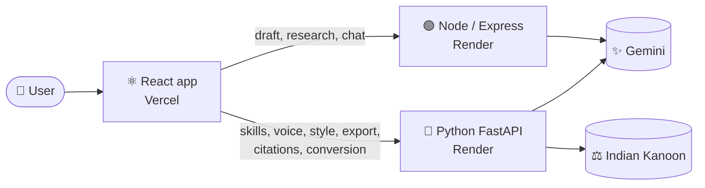

<div align="center">

# ⚖️ DraftMate AI
### The Legal Drafting Studio

**Upload a reference → pick a skill → generate → verify citations → edit by voice → export.**
*One screen. Zero guesswork.*

<br>

[](https://draftmate-app-snowy.vercel.app)
[](https://draftmate-app-snowy.vercel.app/drafter)


🏆 Built in 24 hours for **KodeKurrent S2 · RGIPT** · Problem Statement: *Legal Drafting Studio*

</div>

---

> 💤 **Heads up:** the demo runs on free hosting. After about 15 idle minutes the first request takes up to a minute while the servers wake up. After that it is fast.

## ✨ Why DraftMate?

Legal drafting is slow, repetitive and unforgiving. One wrong deadline or one fake case citation can sink a notice. DraftMate is built around three promises:

| 🎯 Promise | How we keep it |
|---|---|
| **Sound like your firm** | Upload a reference document. The draft follows its tone, numbering and clause style, never its facts |
| **Never change the meaning** | A meaning check compares amounts, dates, deadlines and names *before* any revision is applied |
| **Never fake an authority** | Every case and section is checked against a legal database and marked Verified, Needs Review or Not Found |

---

## 🧰 Feature tour

<table>
<tr>
<td width="50%" valign="top">

### 📄 Bring your own documents
Upload PDF, Word, PowerPoint, Excel, HTML or text. Everything is converted to clean Markdown. Attach several at once and mix in saved templates.

### 🎨 Reference-style adaptation
Tone, obligation verbs (*shall / will / must*), numbering, heading case and defined terms are learned from your reference and applied to every draft and revision.

### 🧩 68 skills, one sentence away
Click a chip, type `@contract-review`, or just say *"use contract review"*. Each skill is a small JSON file, so adding one takes minutes.

</td>
<td width="50%" valign="top">

### 🎙️ Voice agent
Dictate, replace, rewrite, insert, undo, read back, export, switch skills. A live status line shows what it heard. **Deleting or overwriting always asks for a yes first.**

### 🔍 Citation verification
A separate panel checks each authority against Indian Kanoon, an accessible public legal database, and colour-codes the result.

### 🪙 Token-smart by design
Markdown conversion, selective retrieval of relevant sections, a prompt-quality meter and a live *"tokens saved"* readout. Your draft always goes whole; only attached material is trimmed.

</td>
</tr>
</table>

**Plus:** one-click layout presets (letter, contract, plain English), Word and PDF export, contract risk radar and redlining, deadline extraction, legal research with AI summaries, and version history.

---

## 📋 Requirements scoreboard

| # | Problem statement requirement | Status | Where to see it |
|---|---|:---:|---|
| **R1** | Upload documents, templates, drafts, references | ✅ | *Reference document* box and *Reference materials and templates* |
| **R2** | Text or voice to generate, revise, format, review | ✅ | AI assistant, voice panel, *Format the draft* menu |
| **R3** | Adopt a reference style, keep the meaning | ✅ | Reference upload plus the meaning-check banner |
| **R4** | Dynamic skills, natural-language invocation | ✅ | Skill chips, `@skill` typing, voice, Skills Library |
| **R5** | Citation verification | ✅ | *Citation check* panel |
| **R6** | Voice agent with status and confirmation | ✅ | Voice panel, try *"delete paragraph two"* |
| **R7** | Token and context management | ✅ | Token-savings line, prompt meter, size selector |
| **R8** | Minimal UI with model picker and separate verification panel | ✅ | The Drafter page |

---

## 🎬 The 3-minute demo

```text
 1 📤  Upload a formal agreement as the Reference document
 2 ✍️  Fill in a rent-default legal notice → Generate legal draft
 3 🧩  Click a skill chip (or type @legal-notice-drafting) → review → Replace draft
 4 🎙️  Say "make it more formal", then "delete paragraph two" → watch it ask first
 5 🔍  Check citations → Verified / Needs Review / Not Found
 6 📥  Export Word (.docx) or PDF
```

👉 **[Try it live](https://draftmate-app-snowy.vercel.app/drafter)**

---

## 🏗️ Architecture



| Part | Folder | Port | Responsibility |
|---|---|:---:|---|
| ⚛️ React frontend | `frontend/` | 3000 | Every page and the Drafter assistant |
| 🟢 Node server | `frontend/server/` | 5000 | Draft generation and *Ask DraftMate* chat, with Gemini retry, model fallback and friendly quota messages |
| 🐍 Python backend | `backend/` | 8000 | Skills, voice commands, reference style, meaning check, conversion, token optimisation, citations, contract tools, Word and PDF export |

<details>
<summary><b>🗺️ Source map (click to expand)</b></summary>

| Area | Files |
|---|---|
| Skills and routing | `backend/skills_registry.py`, `backend/skills_data/` (68 JSON skills), `backend/agent_routes.py` |
| Voice agent | `backend/voice_agent.py`, `frontend/src/components/VoiceAgent.js` |
| Reference style and meaning check | `backend/style_profile.py`, `frontend/src/components/ReferenceStyle.js` |
| Token and context management | `backend/token_optimizer.py`, `backend/context_opt.py`, `frontend/src/components/ContextTools.js` |
| Document conversion | `backend/file_to_markdown.py`, `backend/doc_convert.py` |
| Citation verification | `backend/citation_verifier.py` |
| Export | `backend/export_docx.py` (Word and PDF), `frontend/src/components/exportDraft.js` |
| Model access | `backend/llm_client.py`, `backend/ai_service.py`, `frontend/server/gemini.js` |
| Drafter UI | `frontend/src/pages/Drafter.js`, `frontend/src/components/DraftAssistant.js` |

</details>

---

## 🧠 Under the hood

<details>
<summary><b>🧩 Skills</b></summary>

A skill is a JSON file with a name, description, instructions and the inputs it needs. The router matches typed or spoken text to a skill, then the skill's instructions and your document go to the model. Drop a new file into `backend/skills_data/` and it appears in the library.

</details>

<details>
<summary><b>🎨 Reference style</b></summary>

Rule-based, not a model call, so it is instant and free. It measures obligation verbs, numbering style, heading case and defined terms, then turns them into a style guide in the draft prompt. The model is told to copy style only and never reuse names, amounts or dates.

</details>

<details>
<summary><b>🛡️ Meaning check</b></summary>

Deterministic. It extracts amounts, dates, time limits and names from the old and new text and lists anything missing or new, so a "make it more formal" rewrite cannot quietly change a deadline.

</details>

<details>
<summary><b>🔍 What the citation statuses mean</b></summary>

- 🟢 **Verified:** the authority exists under that name and year in a legal source.
- 🟡 **Needs Review:** a partial match.
- 🔴 **Not Found:** no matching authority, so do not rely on it.

It does not confirm what a judgment says. A lawyer must always read the source.

</details>

<details>
<summary><b>🪙 Token control</b></summary>

Documents are converted to Markdown, split into sections and ranked against your request. Only the relevant sections go to the model, within a budget you choose (small, normal or large). The app shows how many tokens were saved.

</details>

---

## 🚀 Run it locally

```bash
# 🐍 1. Python backend
cd backend
cp .env.example .env        # add INDIANKANOON_API_TOKEN and GEMINI_API_KEY
python3 -m pip install -r requirements.txt
python3 -m uvicorn main:app --reload --port 8000

# 🟢 2. Node server
cd frontend/server
cp .env.example .env        # add GEMINI_API_KEY
npm install
npm start

# ⚛️ 3. React app
cd frontend
npm install --legacy-peer-deps
npm start                   # opens http://localhost:3000
```

> 🍎 On macOS, turn off **AirPlay Receiver** (System Settings → General → AirDrop & Handoff) or port 5000 answers 403.
>
> 🩺 Visit `http://localhost:8000/status` to see which keys are loaded. Without keys the app still runs; AI answers and live case search are off.

<details>
<summary><b>🔑 Environment variables</b></summary>

| Variable | Where | Purpose |
|---|---|---|
| `GEMINI_API_KEY` | Python and Node | Drafting, revisions, chat |
| `INDIANKANOON_API_TOKEN` | Python | Citation verification and case search |
| `ANTHROPIC_API_KEY`, `OPENAI_API_KEY` | Python (optional) | Adds Claude and GPT tiers to the model picker |
| `DRAFTMATE_CORS` | Python | Web addresses allowed to call the backend (comma-separated) |
| `CORS_ORIGINS` | Node | Web addresses allowed to call the Node server (comma-separated) |
| `REACT_APP_API_URL`, `REACT_APP_NODE_URL` | React build | Addresses of the Python and Node servers (default `localhost`) |

`.env` files are git-ignored. Never commit them.

</details>

---

## ☁️ Deploy your own

| Step | Service | Settings |
|:---:|---|---|
| 1 | 🐍 **Render**, Python | Root `backend` · build `pip install -r requirements.txt` · start `uvicorn main:app --host 0.0.0.0 --port $PORT` · set `GEMINI_API_KEY`, `INDIANKANOON_API_TOKEN`, `DRAFTMATE_CORS` |
| 2 | 🟢 **Render**, Node | Root `frontend/server` · build `npm install` · start `node index.js` · set `GEMINI_API_KEY`, `CORS_ORIGINS` |
| 3 | ⚛️ **Vercel**, React | Root `frontend` · install `npm install --legacy-peer-deps` · set `REACT_APP_API_URL`, `REACT_APP_NODE_URL`, `CI=false` · production branch `integrated-app` |

`render.yaml` describes the two Render services.

---

## 🧪 Tests

```bash
cd backend && python3 -m pip install pytest httpx && python3 -m pytest -q
```

**135 tests** cover skills routing, voice commands, style profile and meaning check, export, conversion, token optimisation, citations, contract tools and the document store.

---

## ⚠️ Good to know

- ⚖️ AI output is general information, **not legal advice**. A qualified lawyer must review every draft and every citation.
- 💾 On the free tier, saved templates and uploads are lost when a server restarts.
- 📉 Gemini's free quota is shared across a key. When it runs out, the app shows a clear message instead of retrying.
- 🔐 Secrets live only in environment settings and `.env` files.

---

<div align="center">

### 🏁 Built with care in 24 hours

**DraftMate AI team · KodeKurrent S2 · RGIPT**

[🚀 Live demo](https://draftmate-app-snowy.vercel.app) · [✍️ Drafter](https://draftmate-app-snowy.vercel.app/drafter)

</div>
